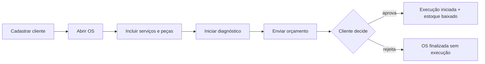

# Event Storming

Legenda: 🟧 **Evento de domínio** (passado) · 🟦 **Comando** · 🟨 **Ator** · 🟪 **Política / regra de negócio** · 🟫 **Agregado** · 🟩 **Visão de leitura**

**Atores:** Atendente, Mecânico, Cliente, Responsável pelo estoque (todos os administrativos autenticados via JWT são o papel `ADMIN` no MVP).

---

## 1. Criação da Ordem de Serviço

| Ordem | 🟨 Ator | 🟦 Comando | 🟫 Agregado | 🟧 Evento de domínio | 🟪 Política / regra |
|---|---|---|---|---|---|
| 1 | Atendente | Cadastrar cliente | Cliente | Cliente cadastrado | CPF/CNPJ válido e único |
| 2 | Atendente | Abrir OS (CPF/CNPJ + veículo + itens) | OrdemServico | OS aberta (status *Recebida*) | Cliente deve existir; placa válida |
| 2a | — | (reaproveita ou cadastra veículo) | Veiculo | Veículo cadastrado | Placa única; veículo deve ser do mesmo cliente |
| 3 | Atendente | Incluir serviço / peça | OrdemServico | Serviço incluído · Peça incluída | Só em *Recebida* ou *Em diagnóstico*; preço congelado |
| 4 | Mecânico | Iniciar diagnóstico | OrdemServico | Diagnóstico iniciado (*Em diagnóstico*) | Só a partir de *Recebida* |
| 5 | Mecânico | Enviar orçamento | OrdemServico | Orçamento gerado · Orçamento enviado (*Aguardando aprovação*) | Exige ao menos 1 serviço/peça; total = serviços + peças × qtd |
| 6 | Cliente | Aprovar orçamento | OrdemServico + Peca | Orçamento aprovado · Execução iniciada (*Em execução*) · Estoque baixado | **Baixa de estoque na mesma transação**; sem saldo → nada muda |
| 6' | Cliente | Rejeitar orçamento | OrdemServico | Orçamento rejeitado · OS finalizada (sem execução) | Encerra a OS; veículo pode ser entregue |

---

## 2. Acompanhamento da Ordem de Serviço

| Ordem | 🟨 Ator | 🟦 Comando | 🟫 Agregado | 🟧 Evento | 🟪 Política |
|---|---|---|---|---|---|
| 1 | Cliente | Consultar andamento (código de acompanhamento) | OrdemServico | — (🟩 visão: status, itens, orçamento, datas) | Código UUID é o segredo; resposta sem dados pessoais |
| 2 | Mecânico | Finalizar execução | OrdemServico | Execução finalizada (*Finalizada*) | Só a partir de *Em execução*; registra fim da execução |
| 3 | Atendente | Entregar veículo | OrdemServico | Veículo entregue (*Entregue*) | Só a partir de *Finalizada* |
| 4 | Gerente | Consultar tempo médio de execução | OrdemServico (leitura) | — (🟩 média de aprovação→finalização) | Considera só OS que foram executadas |

**Regras de transição (política central):**
`Recebida → Em diagnóstico → Aguardando aprovação → Em execução → Finalizada → Entregue` · alternativa: `Aguardando aprovação → Finalizada` (rejeição). Qualquer outra transição é recusada (HTTP 422).

---

## 3. Gestão de peças e insumos

| Ordem | 🟨 Ator | 🟦 Comando | 🟫 Agregado | 🟧 Evento | 🟪 Política |
|---|---|---|---|---|---|
| 1 | Resp. estoque | Cadastrar peça | Peca | Peça cadastrada | Código único; preço e estoque não negativos |
| 2 | Resp. estoque | Registrar entrada | Peca | Estoque reposto | Quantidade > 0 |
| 3 | Resp. estoque | Registrar saída manual | Peca | Estoque baixado | Quantidade > 0 e ≤ saldo |
| 4 | Sistema (aprovação da OS) | Baixar estoque da OS | Peca | Estoque baixado | Tudo-ou-nada com a aprovação; lock otimista (`@Version`) |
| 5 | Sistema | Avaliar estoque mínimo | Peca | Estoque baixo detectado | Saldo ≤ estoque mínimo → consta em `GET /pecas/estoque-baixo` |
| 6 | Resp. estoque | Atualizar / remover peça | Peca | Peça atualizada · Peça removida | Remoção recusada (409) se a peça estiver em uso |

---

## Bounded Contexts identificados
1. **Atendimento e Execução (núcleo / core domain)** — `OrdemServico` e seus itens; ciclo de vida, orçamento, aprovação.
2. **Cadastros (suporte)** — `Cliente` e `Veiculo`.
3. **Catálogo e Estoque (suporte)** — `Servico` e `Peca`.

No MVP os três vivem no mesmo monolito; a OS referencia os demais agregados por identidade e guarda um *snapshot* de nome/preço dos itens.
